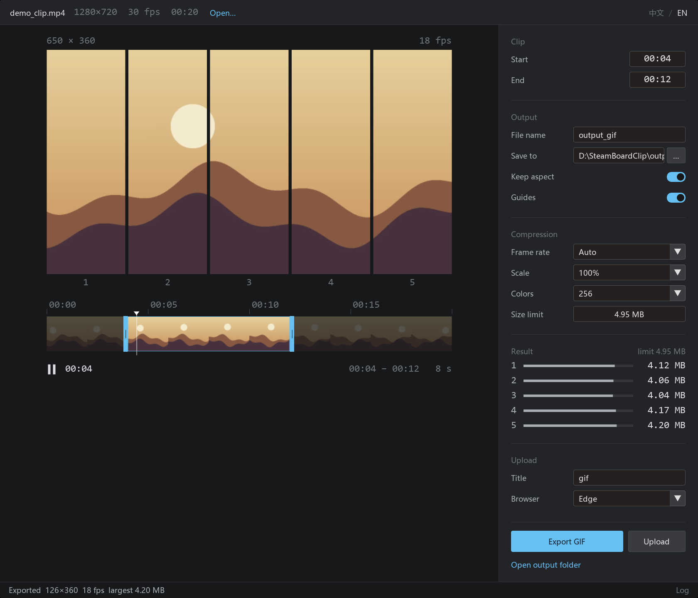

# SteamBoardClip

[简体中文](README.md) | **English**

Turn a video clip into the five side-by-side GIFs that make up an animated
Steam profile showcase, then upload them to the Steam workshop.



## What it does

- Cuts a time range of any video into five 126×360 columns, with the 5 px
  gutters Steam draws between showcase slots already accounted for, so the
  picture lines up when the five items sit next to each other.
- Keeps every part under Steam's 5 MB limit and picks the **highest frame rate
  that fits**. All five parts always share one frame rate and one size, so they
  stay in sync.
- Shows the result before you export: the preview is the real output canvas at
  1:1, split into the five columns.
- Uploads the five GIFs as workshop items from Edge or Chrome.

## Download and run

Download the release, unzip it anywhere and run `SteamBoardClip.exe`.
Nothing else needs to be installed: ffmpeg is bundled.

Requirements: Windows 10/11, 64-bit. A graphics driver with OpenGL 3 is needed
for the window; no dedicated GPU and no CUDA are used.

## How to use

1. **Open…** a video (mp4, mkv, mov, avi, m4v, webm, flv, wmv).
2. Drag the two blue handles on the timeline to choose the clip, or drag the
   **Start** / **End** values on the right. The preview loops over the selection.
3. Press **Export GIF**. Progress is shown in the status bar; **Cancel** stops it.
4. The five files are written as `<file name>_part1.gif` … `_part5.gif` in the
   output folder. Their sizes appear under **Result**.
5. Press **Upload** to send them to the Steam workshop (see below), then add a
   *Workshop Showcase* to your Steam profile and pick the five items left to right.

## Compression

The size of a GIF is decided by frame rate, resolution and number of colours.
SteamBoardClip balances these for you:

1. Render at full resolution with a conservative frame rate.
2. If every part is well under the limit, raise the frame rate and render again.
3. If a part is over the limit, lower the frame rate.
4. Only when the frame rate is at its floor (2 fps) and a part is still too
   large, scale all five parts down proportionally (never below 50%).

The **Compression** group lets you steer this:

| Option | Meaning |
| --- | --- |
| Frame rate | `Auto` uses the highest that fits. A value is an upper bound. |
| Scale | Proportional resolution of every part, 100% to 50%. |
| Colors | Palette size per frame: 256, 128, 64 or 32. Fewer colours, smaller files. |
| Size limit | Maximum size of each part. Default 4.95 MB. |

Your choices are caps. The size limit is always enforced.

**Keep aspect** centre-crops the video to the showcase shape. Switch it off to
stretch the whole frame instead.

## Uploading to Steam

**Upload** opens the Steam workshop upload page in Edge or Chrome and creates
five items named `<title>_1` … `<title>_5`.

- Sign in to Steam in the browser window that opens. The app waits up to five
  minutes for you.
- Optional: a `user.txt` next to the executable (line 1 account name, line 2
  password) is typed into the sign-in form for you; the upload stops with a
  message when the sign-in form is not found. The file is plain text, so only
  use it on a computer you trust. Steam Guard still has to be confirmed by hand.
- The browser stays open when the upload ends so you can check the result.

## Performance on low-spec machines

- Decoding, scaling and GIF encoding all run on the CPU.
- ffmpeg downsizes each frame while decoding, so 1080p and 4K sources cost
  little more than small ones.
- The five parts are produced in a single decode pass per attempt.
- A render never holds more than 2400 frames in memory (about 550 MB).
- The preview decodes at most 20 frames per second and the window stops
  redrawing when nothing is playing.

## Run from source

```bash
pip install -r requirements.txt
python SteamBoardClip.py
```

Python 3.10 or newer.

## Build the executable

```powershell
pip install -r requirements-dev.txt
.\build.ps1
```

The app is written to `dist\SteamBoardClip\`. Distribute the whole folder.

## Tests

```bash
python -m pytest tests
```

## Project layout

| Path | Content |
| --- | --- |
| `SteamBoardClip.py` | Entry point |
| `app/planning.py` | Showcase geometry, frame rate and resolution balance, validation |
| `app/splitter.py` | Decoding and GIF rendering |
| `app/preview.py` | Preview playback and timeline thumbnails |
| `app/upload/` | Selenium upload |
| `app/ui/` | Dear ImGui interface |
| `tests/` | Tests |

Settings and the log are stored in `%LOCALAPPDATA%\SteamBoardClip`.
