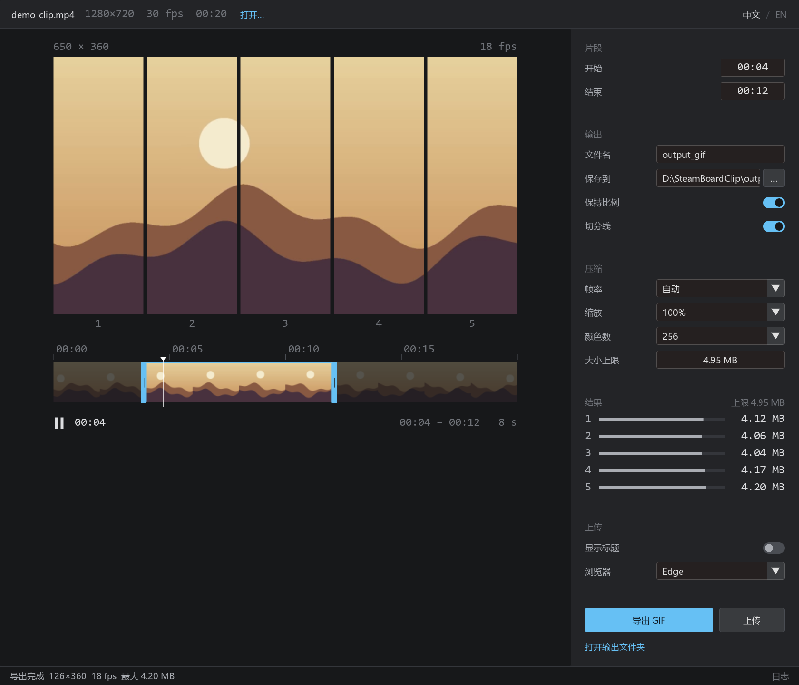

# SteamBoardClip

**简体中文** | [English](README.en.md)

把一段视频切成 5 张并排的 GIF，拼成 Steam 个人资料上的动态展柜，并上传到 Steam 创意工坊。

## 功能

- 把视频的任意时间段切成 5 列 126×360 的 GIF。Steam 展柜格子之间的 5 px 空隙已经算在内，5 张并排后画面能对齐。
- 每一段都控制在 Steam 的 5 MB 上限以内，并且取**预算内最高的帧率**。5 段始终使用同一帧率、同一尺寸，播放保持同步。
- 导出前就能看到效果：预览按实际输出尺寸 1:1 显示，并按 5 列切开。
- 用 Edge 或 Chrome 把 5 张 GIF 上传为创意工坊条目。

## 下载运行

1. 在 [Releases](https://github.com/Cyy0818/SteamBoardClip/releases) 页面下载 `SteamBoardClip-v1.0.0-windows-x64.zip`。
2. 在压缩包上点击右键，选择"全部解压缩"，把整个 `SteamBoardClip` 文件夹解压到任意位置。
3. 打开解压出来的 `SteamBoardClip` 文件夹，双击 `SteamBoardClip.exe`。

文件夹里有 `SteamBoardClip.exe` 与 `_internal` 文件夹，两者必须放在一起。`_internal` 里是程序运行需要的文件，单独把 exe 拿出来或者在压缩包里直接双击，程序都无法启动。

不需要另外安装任何东西，ffmpeg 已内置。

运行要求：Windows 10/11 64 位。窗口显示需要支持 OpenGL 3 的显卡驱动；不需要独立显卡，也不使用 CUDA。

## 使用方法

1. 点 **打开…** 选择视频（mp4、mkv、mov、avi、m4v、webm、flv、wmv）。
2. 在时间轴上拖动两个蓝色手柄选择片段，或者拖动右侧的 **开始** / **结束** 数值。预览会在选中的片段内循环播放。
3. 点 **导出 GIF**。进度显示在底部状态栏，点 **取消** 可以中止。
4. 5 个文件以 `<文件名>_part1.gif` … `_part5.gif` 保存到输出文件夹，各自的大小显示在 **结果** 里。
5. 点 **上传** 发送到创意工坊（见下文），然后在 Steam 个人资料里添加"创意工坊展柜"，从左到右依次选这 5 个条目。

## 压缩

GIF体积由帧率、分辨率和颜色数决定。SteamBoardClip 会自动平衡这三项：

1. 先用原始分辨率和偏保守的帧率渲染一遍。
2. 如果每一段都明显小于上限，就提高帧率重新渲染。
3. 如果有一段超过上限，就降低帧率。
4. 只有帧率降到下限（2 fps）仍然超标时，才把 5 段一起等比例缩小（最低 50%）。

**压缩** 一组选项可以手动干预：

| 选项 | 含义 |
| --- | --- |
| 帧率 | `自动` 取预算内最高值；选具体数值表示帧率上限。 |
| 缩放 | 每一段的等比例分辨率，100% 到 50%。 |
| 颜色数 | 每帧调色板大小：256、128、64 或 32。颜色越少文件越小。 |
| 大小上限 | 每一段的最大体积，默认 4.95 MB。 |

手动设置的值是上限，大小上限始终会被保证。

**保持比例** 会把视频居中裁剪成展柜的形状；关掉则把整个画面拉伸填满。

## 上传到 Steam

点击 **上传** 会用 Edge 或 Chrome 打开创意工坊上传页面，依次创建 5 个条目。

- **显示标题** 关闭（默认）：条目的标题在提交之前被替换成空白字符，橱窗里每一格的下方不显示名称。
- **显示标题** 打开：填写一个标题，5 个条目的名称是 `<标题>_1` … `<标题>_5`。

- 请在弹出的浏览器窗口里登录 Steam，程序最多等待 5 分钟。
- 可选：在程序同目录放一个 `user.txt`（第 1 行账号，第 2 行密码），程序会替你填入登录表单；找不到登录表单时上传会终止并提示。这个文件是明文，只建议在自己信任的电脑上使用；Steam 令牌仍然需要手动确认。
- 上传结束后浏览器不会关闭，方便检查结果。

## 低配置电脑

- 解码、缩放、GIF 编码全部在 CPU 上完成。
- ffmpeg 在解码时就把画面缩小，1080p 和 4K 视频的开销和小视频相差不大。
- 每次尝试只解码一遍，同时产出 5 段。
- 单次渲染在内存里最多保留 2400 帧（约 550 MB）。
- 预览每秒最多解码 20 帧；没有内容在播放时窗口停止重绘。

## 目录结构

| 位置 | 内容 |
| --- | --- |
| `SteamBoardClip.py` | 入口 |
| `app/planning.py` | 展柜几何、帧率与分辨率的平衡、参数校验 |
| `app/splitter.py` | 解码与 GIF 渲染 |
| `app/preview.py` | 预览播放与时间轴缩略图 |
| `app/upload/` | Selenium 上传 |
| `app/ui/` | Dear ImGui 界面 |
| `tests/` | 测试 |

设置和日志保存在 `%LOCALAPPDATA%\SteamBoardClip`。
